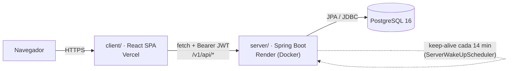
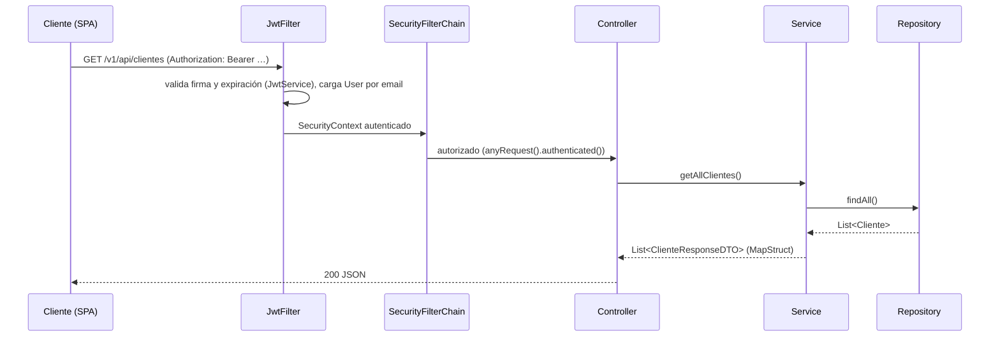
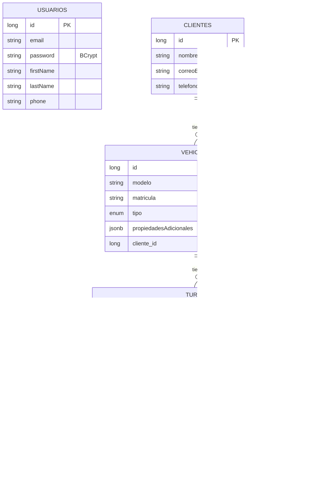

# Arquitectura

## Componentes (actual)

En local: front en Vite (:5173), back en :8080, Postgres en Docker (:5432). Hoy el front local llama a la API de producción (T-003).

## Flujo de una request

- Capas: `controller` (HTTP + `@Valid`) → `service` (interfaz + `impl/`, reglas de negocio, `ResponseStatusException`) → `repository` (Spring Data JPA). DTOs separados de las entidades.
- Errores: `exception/GlobalExceptionHandler.java` → `{"error": "..."}` o `{"campo": "mensaje"}` para validación. Errores no manejados → 403 (T-013).

## Autenticación

1. `POST /v1/api/auth/register` o `/auth/login` (públicos) → `AuthenticationManager` + BCrypt → JWT HS256 firmado con `SECRET`, subject = email, expira en 10 días (`config/jwt/JwtService.java`).
2. El front guarda `token` y `user` en `localStorage` (`client/src/services/Api.tsx`) y manda `Authorization: Bearer` en cada request.
3. `JwtFilter` autentica cada request; sesión `STATELESS`, CSRF deshabilitado, CORS `*` (`config/security/SecurityConfig.java`, `config/CorsConfig.java`).
4. No hay roles: todo usuario autenticado puede todo.

## Modelo de datos

`usuarios` (operadores del sistema) no se relaciona con `clientes` (dueños de vehículos). Esquema generado por Hibernate (`ddl-auto=create`), sin migraciones.

## Endpoints

Base `/v1/api`. Todos requieren JWT salvo los marcados 🔓. Contrato vivo: `/v3/api-docs` (Swagger UI en `/swagger-ui/index.html`).

| Método | Ruta | Qué hace | Front |
|---|---|---|---|
| POST 🔓 | `/auth/register` | Crea usuario y devuelve JWT | Register |
| POST 🔓 | `/auth/login` | Devuelve JWT + datos del usuario | Login |
| GET 🔓 | `/render/health` | Health check (texto) | — |
| GET / POST | `/clientes` | Listar / crear cliente | Dashboard |
| GET | `/clientes/{id}` | Cliente con sus vehículos | ClientVehicles |
| POST | `/vehiculos` | Crear vehículo de un cliente | ClientVehicles |
| GET | `/vehiculos/{id}` · `/vehiculos/cliente/{clienteId}` | Vehículo · vehículos de un cliente | Turnos · ClientVehicles |
| POST | `/turnos` | Crear turno (fecha futura) | Turnos |
| GET | `/turnos/{id}` · `/turnos/vehiculo/{vehiculoId}` | Turno · turnos de un vehículo | Turnos |
| PUT | `/turnos/{id}/en-proceso` · `/turnos/{id}/finalizado` | Cambiar estado | Turnos |
| POST | `/cobros` | Cobrar turno FINALIZADO (uno por turno) | Turnos |
| POST | `/demo` | Endpoint de prueba (sobrante) | — |

## Arquitectura objetivo (resumen; detalle en ADRs y Backlog)

- Perfiles `dev` / `prod` con esquema versionado (Flyway) y seed solo en dev (T-014).
- Errores con `ProblemDetail` y 401/403 correctos (T-013).
- Front con capa de API única (`VITE_API_URL`, manejo de 401) (T-003 + Backlog).
- Tests de integración con Testcontainers ([ADR 0001](adr/0001-testcontainers-postgres-over-h2.md)); actualización Boot 3.3 → 3.5 → 4.x ([ADR 0002](adr/0002-spring-boot-upgrade-path.md)).
